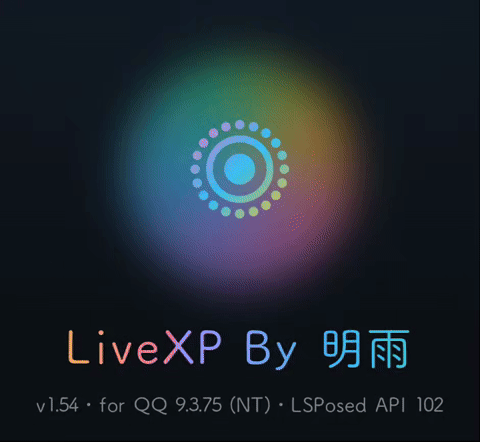
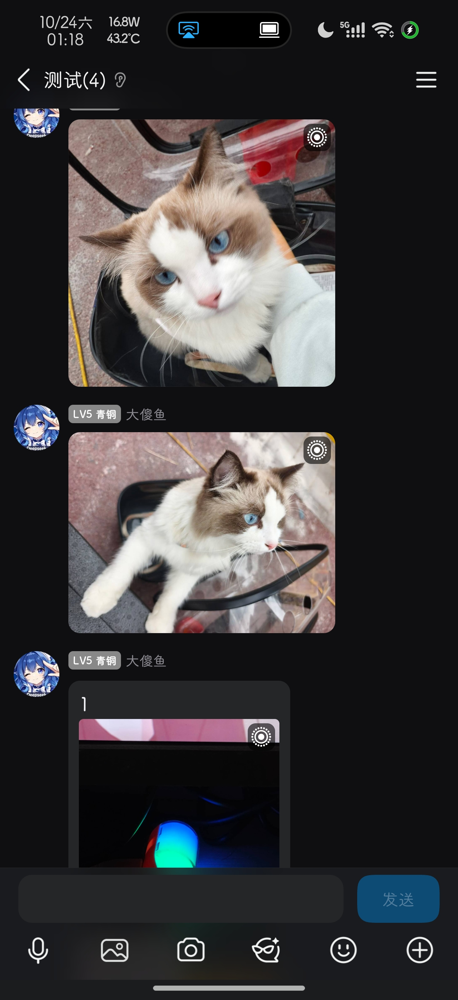
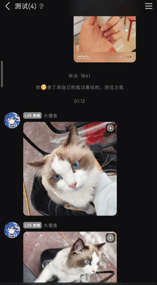

# LiveXP

LiveXP是一个实现 QQ 实况功能的开源 Xposed 模块.
在聊天界面检测**实况图片**(Live Photo / Motion Photo),给对应气泡加「实况」角标;点开大图自动播放内嵌动态视频。

> **当前版本 v1.58**(versionCode 59)

## 功能

- **实况角标**:聊天里的实况图片气泡右上角显示白色点环图标
- **实况播放**:点开已确认的实况图自动播放一次内嵌视频,右上角留实况图标作重播按钮
- **翻页续播**:相册内左右滑动切到下一张实况图自动播放,拖动即停播

## 实况角标

聊天里的每张实况图都会显示点环角标,多图消息也逐张标注。

## 实况播放

点开实况图自动播放一次内嵌视频,播完回到照片;左右翻页会自动续播。

## 实况图检测说明

> 实况图仅检测 1MB 以上文件,是实现原理导致。目前已实测 OPPO、小米实况图,其他待测。OPPO 实况示例图在 [samples/oppo/](samples/oppo/),可以用电脑 QQ 发送到 QQ 聊天,在手机上体验查看实况照片。

## 用法

LSPosed 里启用模块并勾选 QQ 作用域,重启 QQ:
- 发几张实况图片,享受官方QQ鸽了不知道多久的功能吧!
- QQ 设置页出现「LiveXP 模块」入口,点进关于页有一些信息
> **发送提示**:必须发送/接收**实况照片原图**。不要压缩图片,也不要通过系统「分享」把图片发到 QQ——一加相册分享到 QQ 会破坏实况数据,模块将识别不到。

## 反馈问题

提交 issue 时请尽量附上模块日志文件,方便定位问题,路径是:

`/storage/emulated/0/Android/data/com.tencent.mobileqq/LiveXP/livexp.log`

最好再附一段**视频或动图**示意 bug 的复现过程,比文字描述更容易定位。

## 兼容性

- 已实测通过:OPPO、小米
- 极大概率通过:荣耀、魅族、三星、vivo 单文件、谷歌原生
- 苹果(QQ转码无解?);华为(不道啊)
- vivo 双文件:QQ发送层不带MP4信息,只能等QQ下辈子把微信的人才挖过来更新

## 已验证的环境

- KSU + LSPosed 2.2.1(7925)+ Android 17(arm64)
- QQ 9.2.66 / 9.3.70 / 9.3.75 测试通过(疑似适用范围很广)

## 构建

需要 JDK 17+(实测 Android Studio 自带 JBR 21)与 Android SDK 36。建议直接拿 release。

## 未完成工作

- **HDR 渲染**:没肘赢系统优秀的 HDR→SDR 渲染管线,实况图多为HDR信息,播放开始的前 0.7 秒可能会有较大的亮度变化。

- **适配范围**:除 OPPO、小米外的其他机型实况照片尚未实测,QQ版本测试不多(但应该很广),可能存在兼容性问题。

## 致谢与开源说明

- **Qoder 与 deepseek-v4.1-flash / glm-5.3-flash / qwen-3.8-flash** 还有我的小手机(一加 15) :)
- **[QAuxiliary](https://github.com/cinit/QAuxiliary)** —— 提供了很多思路。
- **FUNBOX** —— 本人最喜欢的模块,给了我很大的动力。
- [LSPosed](https://github.com/LSPosed/LSPosed)、[XposedBridge](https://github.com/rovo89/XposedBridge)、[AndroidX](https://github.com/androidx/androidx) 还有我可爱的群友们 等等

完整清单也在模块关于页底部的「致谢和开源使用说明」里。以上项目版权归各自作者所有。

## 许可证

本项目以 [GPL-3.0](LICENSE) 协议开源,Copyright (C) 2026 明雨 (mingyu0401)。

分发或修改后的版本需同样以 GPL-3.0 开源并提供源码。仅供学习与个人使用,请勿用于修改 QQ 服务器数据或商业用途。

## 赞助

功能全部免费,自愿赞赏,不打赏也完全不影响使用。(图片同样在 [DONATE.md](DONATE.md) 里):

